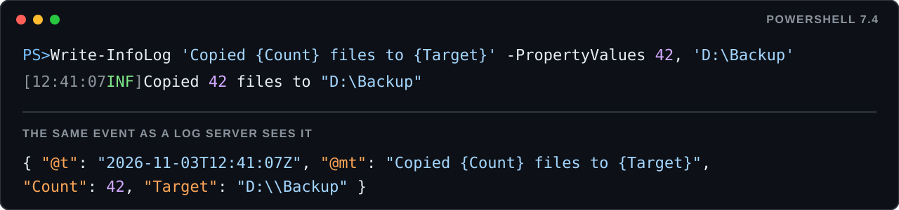
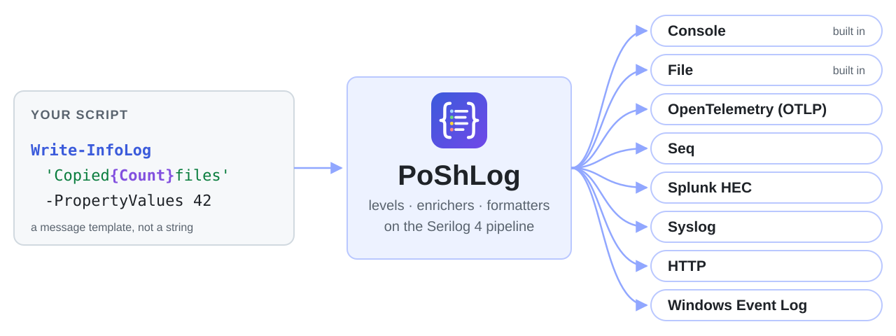

<p align="center">
  <picture>
    <source media="(prefers-color-scheme: dark)" srcset="docs/assets/banner-dark.svg">
    
  </picture>
</p>

<p align="center">
  <a href="https://github.com/PoShLog/PoShLog/actions/workflows/ci.yml"></a>
  <a href="https://www.powershellgallery.com/packages/PoShLog/"></a>
  <a href="https://www.powershellgallery.com/packages/PoShLog/"></a>
  <a href="docs/v2-or-v3.md"></a>
  <a href="LICENSE"></a>
  <a href="https://discord.gg/FVdVxuw"></a>
</p>

<p align="center">
  <b>Write structured log events from PowerShell to the console, files, Seq, OpenTelemetry, Elasticsearch, Splunk, syslog and more.</b>
</p>

<p align="center">
  <a href="#quick-start">Quick start</a> ·
  <a href="#sinks">Sinks</a> ·
  <a href="#documentation">Documentation</a> ·
  <a href="docs/v2-or-v3.md">v2 or v3?</a> ·
  <a href="CHANGELOG.md">Changelog</a>
</p>

> [!NOTE]
> **PoShLog 3 is in preview.** Repository builds support Windows PowerShell 5.1 on .NET Framework 4.7.2+ and
> PowerShell 7.6+ on Windows, Linux and macOS. Desktop phase 1 includes Core logging and non-expression JSON.
> Expression filters and refreshed extensions require PowerShell 7.6+. Desktop support is unreleased.
> See [compatibility and installation](docs/compatibility.md) for the published versions and [v2 or v3](docs/v2-or-v3.md) for migration.

## Why PoShLog

- **Structured, not just text.** Messages are [templates](docs/usage.md): `{Count}` stays a number that Seq, Splunk or
  any log backend can filter and chart.
- **One logger, many destinations.** Send the same events to the console, a rolling file and a log server, each with
  its own minimum level and format.
- **Built on [Serilog](https://serilog.net/) 4.** You get its levels, enrichers and formatters, and Serilog 4 sink
  packages can be configured directly as an advanced route ([migration guide](docs/guides/migration-v3.md)).
- **Fast and familiar.** A compiled binary module with the same cmdlet names and parameters as v2.

## Quick start

```powershell
Install-Module PoShLog -AllowPrerelease

Start-Logger -Console -FilePath './logs/app.log'

Write-InfoLog 'Copied {Count} files to {Target}' -PropertyValues 42, 'D:\Backup'

Close-Logger
```



Need more control? Build the logger as a pipeline: one minimum level, several sinks, each with its own settings.

```powershell
New-Logger |
    Set-MinimumLevel -Value Verbose |
    Add-SinkConsole |
    Add-SinkFile -Path './logs/app-.log' -RollingInterval Day |
    Add-SinkSeq -ServerUrl 'http://localhost:5341' |    # Install-Module PoShLog.Sinks.Seq
    Start-Logger

Write-VerboseLog 'Starting backup of {Path}' -PropertyValues 'C:\Data'
Write-WarningLog 'Disk {Drive} is {Percent}% full' -PropertyValues 'D:', 91
Write-ErrorLog 'Backup failed' -ErrorRecord $Error[0]

Close-Logger
```

## How it works

<picture>
  <source media="(prefers-color-scheme: dark)" srcset="docs/assets/how-it-works-dark.svg">
  
</picture>

## Sinks

Console, File and the PowerShell streams are built into PoShLog. Everything else is a small extension module you
install next to it.

| Destination | Module | Install | Docs |
|---|---|---|---|
| Console, File, PowerShell streams | PoShLog | built in | [Add-SinkConsole](docs/cmdlets/Add-SinkConsole.md), [Add-SinkFile](docs/cmdlets/Add-SinkFile.md), [Add-SinkPowerShell](docs/cmdlets/Add-SinkPowerShell.md) |
| OpenTelemetry (OTLP): Grafana, .NET Aspire, Datadog, Elastic, any Collector | PoShLog.Sinks.OpenTelemetry | `Install-Module PoShLog.Sinks.OpenTelemetry` | [Add-SinkOpenTelemetry](docs/sinks/Add-SinkOpenTelemetry.md) |
| Seq | PoShLog.Sinks.Seq | `Install-Module PoShLog.Sinks.Seq` | [Add-SinkSeq](extensions/PoShLog.Sinks.Seq/README.md) |
| Splunk HTTP Event Collector | PoShLog.Sinks.Splunk.Hec | `Install-Module PoShLog.Sinks.Splunk.Hec` | [Add-SinkSplunk](docs/sinks/Add-SinkSplunk.md) |
| Syslog (RFC 5424 / 3164 over UDP, TCP, TLS) | PoShLog.Sinks.Syslog.Rfc5424 | `Install-Module PoShLog.Sinks.Syslog.Rfc5424` | [Add-SinkSyslog](docs/sinks/Add-SinkSyslog.md) |
| Elasticsearch and Elastic Cloud (data streams, ECS) | PoShLog.Sinks.Elastic | `Install-Module PoShLog.Sinks.Elastic` | [Add-SinkElasticsearch](docs/sinks/Add-SinkElasticsearch.md) |
| HTTP endpoints | PoShLog.Sinks.Http | `Install-Module PoShLog.Sinks.Http` | [Add-SinkHttp](extensions/PoShLog.Sinks.Http/README.md) |
| Windows Event Log | PoShLog.Sinks.EventLog | `Install-Module PoShLog.Sinks.EventLog` | [Add-SinkEventLog](docs/sinks/Add-SinkEventLog.md) |
| Enrichers: environment, process, exception details | PoShLog.Enrichers | `Install-Module PoShLog.Enrichers` | [Enrichers](docs/enrichers/README.md) |

PoShLog can list and install its extensions itself. `Install-PoShLogExtension` adds `-Prerelease` while PoShLog 3 is
in preview, so you do not have to:

```powershell
Get-PoShLogExtension | Format-Table      # name, kind, version, installed version, commands
Get-PoShLogExtension -Online             # adds the latest version in the Gallery
Install-PoShLogExtension PoShLog.Sinks.Seq
```

Without it, install the extensions with `Install-PSResource <module> -Prerelease` while PoShLog 3 is in preview
([compatibility page](docs/compatibility.md), [Get-PoShLogExtension](docs/cmdlets/Get-PoShLogExtension.md),
[Install-PoShLogExtension](docs/cmdlets/Install-PoShLogExtension.md)). Third-party modules and other Serilog
sinks are listed on the [sinks page](docs/sinks/README.md).

## v2 or v3?

| | PoShLog 3 (preview) | PoShLog 2 |
|---|---|---|
| PowerShell | 7.6+ on Windows, Linux, macOS. Unreleased Windows PowerShell 5.1 support for PoShLog Core only (.NET Framework 4.7.2+) | Windows PowerShell 5.1 and PowerShell 7 |
| Module | compiled, Serilog 4 | script module, Serilog 2 |
| Install | `Install-Module PoShLog -AllowPrerelease` | `Install-Module PoShLog -MaximumVersion 2.99` |
| Status | new features | bug fixes and Serilog updates |

Moving a script over? Read [v2 or v3?](docs/v2-or-v3.md) and the [migration guide](docs/guides/migration-v3.md).

## Documentation

- [Getting started](docs/getting-started.md) and [usage](docs/usage.md)
- [Compatibility and installation](docs/compatibility.md): which versions work together, installing the preview
- [Log event levels](docs/log-event-levels.md)
- [Cmdlet reference](docs/cmdlets/README.md)
- [Sinks](docs/sinks/README.md) and [enrichers](docs/enrichers/README.md)
- [Capturing output](docs/guides/capturing-output.md) of existing scripts
- Migrating from [PoShLog 2](docs/guides/migration-v3.md), [Write-Host and transcripts](docs/guides/migration-write-host.md) or [PSFramework](docs/guides/migration-psframework.md)
- [FAQ and troubleshooting](docs/guides/faq.md)
- [Recipes](docs/recipes/README.md): scheduled scripts, GitHub Actions, Pester tests
- [Extension modules](docs/guides/extension-modules.md) and [creating a sink](docs/guides/creating-sink.md)
- [Architectural decisions](docs/decisions/README.md)

## Contributing

Pull requests are welcome. For bigger changes, please open an [issue](https://github.com/PoShLog/PoShLog/issues) or a
[discussion](https://github.com/PoShLog/PoShLog/discussions) first. [Good first issues](https://github.com/PoShLog/PoShLog/issues?q=is%3Aissue+is%3Aopen+label%3A%22good+first+issue%22)
are a nice place to start, and the [developer guide](docs/guides/for-developers.md) explains the layout.

### Building locally

You need the [.NET 10 SDK](https://dotnet.microsoft.com/download) (or newer) and
[PowerShell 7.6+](https://learn.microsoft.com/powershell/scripting/install/installing-powershell).

```powershell
dotnet build PoShLog.sln
./build/Build-Core.ps1
dotnet test PoShLog.sln
Invoke-Pester ./tests

Import-Module ./src/PoShLog.psd1
Start-Logger -Console
Write-InfoLog 'Hello from PoShLog!'
Close-Logger
```

### Show your support

- ⭐ Star the repository. It is the simplest way to help the project.
- 💬 Share feedback and ideas in [Discussions](https://github.com/PoShLog/PoShLog/discussions) or on [Discord](https://discord.gg/FVdVxuw).
- 🐞 Try the preview and [report issues](https://github.com/PoShLog/PoShLog/issues).

## Authors and contributors

Created and maintained by [**Tomáš Bouda**](http://tomasbouda.cz), with contributions from
[Michael Zimmerli](https://github.com/gitbute), Martin Dennhardt,
[Brady Shober](https://github.com/BradyShober) and [Chris Hunt](https://github.com/cdhunt).

## License

PoShLog is licensed under the [MIT License](LICENSE). The logo and graphics in [docs/assets](docs/assets) are part of
this project and covered by the same license.

## Credits

- [Serilog](https://serilog.net/), the logging library PoShLog is built on.
- The earlier icon in `images/icons` was made by [Smashicons](https://smashicons.com/) from [www.flaticon.com](https://www.flaticon.com/).
