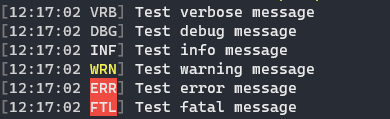
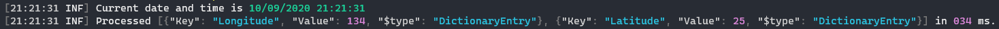
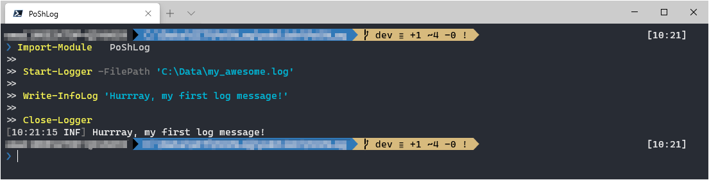

[](https://github.com/PoShLog/PoShLog)

# PoShLog

[](https://www.powershellgallery.com/packages/PoShLog/) [](https://www.powershellgallery.com/packages/PoShLog/) [](https://discord.gg/FVdVxuw) [](https://github.com/PoShLog/PoShLog/actions/workflows/ci.yml) [](https://www.paypal.com/cgi-bin/webscr?cmd=_s-xclick&hosted_button_id=GRARVRTVNEUHS)

>Serilog for powershell

PoShLog is a cross-platform PowerShell logging module. PoShLog allows you to log structured event data into **console**, **file** and much more [places](docs/sinks/README.md) easily.
It's built upon the great C# logging library [Serilog](https://serilog.net/) (v4.2.0).

As of **v3.0.0**, PoShLog is a **compiled C# binary module** (`.NET 8`) — all cmdlets are implemented as compiled `PSCmdlet`/`Cmdlet` classes rather than PowerShell script functions, for better performance and startup time. Cmdlet names, parameters, aliases, and pipeline behavior are unchanged from previous versions. **Requires PowerShell 7.0+ (PowerShell Core)** — Windows PowerShell 5.1 / Desktop edition is no longer supported.

## Key Features

* [x] Structured log event data
* [x] Clean and easy to use [API](docs/cmdlets/README.md)
* [x] Cross-platform
* [x] Compiled C# binary module (.NET 8)
* [x] Easily extensible

## Getting started

If you are familiar with PowerShell, skip to [Installation](#installation) section. For more detailed installation instructions check out [Getting started](docs/getting-started.md).

### Installation

To install PoShLog, run following snippet from powershell:

```ps1
Install-Module PoShLog
```

PoShLog 3 needs PowerShell 7.4 or newer. On Windows PowerShell 5.1 use the maintained v2 line; see [v2 or v3?](docs/v2-or-v3.md).

## Usage

Setup logger using pipeline fluent API and write some log messages(*in this case into file and console*):

```ps1
Import-Module PoShLog

# Create new logger
# This is where you customize, when and how to log
New-Logger |
    Set-MinimumLevel -Value Verbose | # You can change this value later to filter log messages
    # Here you can add as many sinks as you want - see https://github.com/PoShLog/PoShLog/wiki/Sinks for all available sinks
    Add-SinkConsole |   # Tell logger to write log messages to console
    Add-SinkFile -Path 'C:\Data\my_awesome.log' | # Tell logger to write log messages into file
    Start-Logger

# Test all log levels
Write-VerboseLog 'Test verbose message'
Write-DebugLog 'Test debug message'
Write-InfoLog 'Test info message'
Write-WarningLog 'Test warning message'
Write-ErrorLog 'Test error message'
Write-FatalLog 'Test fatal message'

Close-Logger
```



[*For detailed documentation see docs*](docs/getting-started.md)

You can(*and you should*) log formatted data:

```ps1
Write-InfoLog 'Current date and time is {DateTime}' -PropertyValues (Get-Date)

# Some example data
$position = @{
    Latitude = 25
    Longitude = 134
}
$elapsedMs = 34

Write-InfoLog 'Processed {@Position} in {Elapsed:000} ms.' -PropertyValues $position, $elapsedMs
```



Fluent API is too bulky? You don't need extra sinks? Use short setup version(*logs into console and [file](poshlog_example_simplest_file.png)*):

```ps1
# Create and start new logger
Start-Logger -FilePath 'C:\Data\my_awesome.log' -Console

Write-InfoLog 'Hurrray, my first log message!'

# Don't forget to close the logger
Close-Logger
```



### Extendability

PoShLog is extensible just like Serilog. All available extensions can be found [here](docs/guides/extension-modules.md).

### Documentation

These examples are just to get you started fast. For more detailed documentation please check the [docs](docs/getting-started.md):

* [Getting started](docs/getting-started.md)
* [Usage](docs/usage.md)
* [Log event levels](docs/log-event-levels.md)
* [Cmdlets reference](docs/cmdlets/README.md)
* [Sinks](docs/sinks/README.md)
* [Enrichers](docs/enrichers/README.md)
* [Recipes](docs/recipes/README.md) (scheduled scripts, GitHub Actions, Pester)
* [Guides](docs/guides/for-developers.md) (creating a sink, extension modules, contributing)

## Contributing

Pull requests are welcome. For major changes, please open an issue first to discuss what you would like to change.

### Show your support

* :star: Star the PoShLog repository. This is the least you can do to support this project.
* :thumbsup: Give us some feedback or suggest features using [Discussions](https://github.com/PoShLog/PoShLog/discussions) or [discord](https://discord.gg/FVdVxuw)
* :mag_right: Test PoShLog and raise [issues](https://github.com/PoShLog/PoShLog/issues)
* Contribute :rocket: you can start with [good first issues](https://github.com/PoShLog/PoShLog/issues?q=is%3Aissue+is%3Aopen+label%3A%22good+first+issue%22)

### Contributors

* [Michael Zimmerli](https://github.com/gitbute)
* [Martin Dennhardt](https://github.com/mamidenn)
* [Brady Shober](https://github.com/BradyShober)
* [Chris Hunt](https://github.com/cdhunt)

### Building Locally

PoShLog is a compiled .NET 8 binary module. To build and test it locally:

1. Install the [.NET 8 SDK](https://dotnet.microsoft.com/download) and [PowerShell 7+](https://learn.microsoft.com/en-us/powershell/scripting/install/installing-powershell).

2. Build the solution

        dotnet build PoShLog.sln

3. Publish the compiled module into `src/lib`

        dotnet publish src/dotnet/PoShLog.Core.csproj -o src/lib

4. Import and test the module

        Import-Module ./src/PoShLog.psd1
        Start-Logger -Console
        Write-InfoLog 'Hello from PoShLog!'
        Close-Logger

5. Run the tests

        dotnet test tests/PoShLog.UnitTests/PoShLog.UnitTests.csproj
        Invoke-Pester ./tests/PoShLog.Tests.ps1

## Authors

* [**Tomáš Bouda**](http://tomasbouda.cz)

## Release Notes

* [v2.1.1](releaseNotes/v2.1.1.md)
* [v2.1.0](releaseNotes/v2.1.0.md)

## License

This project is licensed under the MIT License - see the [LICENSE](LICENSE) file for details.

## Credits

* Serilog - [serilog.net](https://serilog.net/)
* Icon made by [Smashicons](https://smashicons.com/) from [www.flaticon.com](https://www.flaticon.com/).
